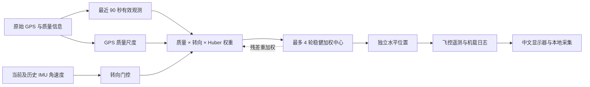

<div align="center">

# StaticPos QRW

**面向 ArduCopter 定点实验的质量加权稳健 GPS 定位算法**

[English](README.en.md) · [快速开始](docs/QUICKSTART.zh-CN.md) · [构建固件](docs/BUILDING.md) · [故障排查](docs/TROUBLESHOOTING.md)

[](https://github.com/2209802176-dev/staticpos-qrw/actions/workflows/ci.yml)

[](LICENSE)


</div>

StaticPos QRW 将最近一段时间的 GPS 观测组成有限窗口，根据观测质量、转向状态和位置残差分配权重，输出二维水平位置估计。它包含可独立使用的 C++11 核心、ArduPilot 接入代码、中文遥测显示器，以及无需实验数据即可运行的合成验证。

飞控执行估计，电脑显示并记录结果。目标平台为 **ArduCopter 4.6.3 / fmuv3 / 单 M8N**，使用范围为**未解锁、固定位置与原地转向研究**。输出为独立研究坐标，保留原飞控导航与控制接口。目标板运行时间、链路连续性和定位效果需要用户自行实测。

## 为什么使用它

- **有限历史**：90 秒滑动窗口限制旧观测的影响；窗口未满时也能开始输出。
- **质量赋权**：结合水平精度、HDOP 和卫星数，降低质量较差观测的基础贡献。
- **稳健估计**：Huber 迭代对远离当前中心的观测软降权。
- **转向门控**：IMU 角速度识别转向，暂时降低对应 GPS 观测的贡献并保留历史。
- **可嵌入核心**：固定容量、无堆分配、C++11；核心不依赖 NumPy、MAVLink 或文件系统。
- **可检查输出**：源时间、快照序号、窗口支持、权重、数据年龄和计算耗时随遥测记录。

## 从输入到输出



RTK、参考坐标、官方导航输出和未来样本不进入估计器。IMU 用于转向识别，没有加速度积分。

## 先在电脑上运行

需要 Python 3.11+、Tk 和支持 C++11 的 GCC。下列检查只使用公开的合成输入，不连接串口。

```bash
git clone https://github.com/2209802176-dev/staticpos-qrw.git
cd staticpos-qrw
python -m venv .venv
# Linux/macOS: source .venv/bin/activate
# Windows PowerShell: .\.venv\Scripts\Activate.ps1
python -m pip install -r requirements.txt
python tools/run_checks.py
```

GCC 未在 PATH 中时，将 `CXX` 设为编译器路径。Linux 无桌面环境可用 `xvfb-run -a python tools/run_checks.py`；只检查无界面部分可加 `--skip-gui`。详见[快速开始](docs/QUICKSTART.zh-CN.md)。

## 使用 C++ 核心

```cpp
#include "core/RobustWindowEstimator.h"

staticpos_v3::RobustWindowEstimator estimator;  // 使用静态存储，避免放入小栈
// GPS 与 IMU 必须使用同一单调微秒时轴；下面坐标是合成示例。
estimator.update_imu(1000000, 0.0, 0.0, 0.0, true);
auto result = estimator.update_gps(
    1000000, 100000000, 200000000, 3, 1.0, 1.0, 12);
if (result == staticpos_v3::UPDATE_OK && estimator.valid(1000000)) {
    auto latitude_e7 = estimator.latitude_e7();
    auto longitude_e7 = estimator.longitude_e7();
    // 在自己的通信接口中使用结果。
}
```

完整 API、容量与失效契约见 [core/README.md](core/README.md)，可直接编译的合成示例见 [examples/](examples/README.md)。核心对象约占 45 KB，应用需要检查目标设备资源余量。

## 构建与上机

1. 按[构建说明](docs/BUILDING.md)准备固定上游和 GNU Arm 工具链，生成完整 fmuv3 APJ。
2. 核对板型与生成的校验清单，按设备原有流程加载自定义固件。
3. Windows 双击 `启动显示器.cmd`，手工选择设备端口和波特率。
4. 在未解锁定点条件下检查 V3 标记、原始 GPS、自研坐标及诊断，再开展原地转向试验。

计算名义 10 Hz，遥测以 50 Hz 分片发送固定快照，目标每秒一批。所有接入点和字段见[飞控接口说明](ardupilot/接入接口说明.md)；上机应完成[验收检查](docs/VALIDATION.md)。电脑不求解优化位置。

## 算法约定

| 项目 | 约定 |
|---|---|
| 窗口 | 最近 90 秒，整数微秒包含端点；GPS 源间隔大于 10 秒建立新段 |
| 质量尺度 | `h_acc`、HDOP、卫星数形成有界经验尺度 `sigma ∈ [0.6, 8] m` |
| 转向 | 角速度模长大于 `0.08 rad/s`，保持至最近一次超阈值后 2 秒 |
| 转向倍率 | 平稳 `lambda=1`，门控有效 `lambda=4`，基础权重 `1/(sigma² lambda)` |
| 稳健项 | `min(1, 3/r)`，其中 `r=norm(position-center)/(sigma*sqrt(lambda))` |
| 求解 | 最多 4 轮；中心变化小于 `1e-7 m` 可提前结束 |
| 容量 | 固定 1024 点；容量损失显式失效，不悄悄缩短窗口 |

质量尺度是经验权重，不是标定协方差；权重支持数不等于独立样本数。窗口平滑可能带来滞后，也不能保证消除持续共同偏差或识别真实平移。适用范围不包含一般飞行导航。

## 仓库内容

```text
core/        独立 C++ 算法与 API 说明
ardupilot/   飞控接入、调度、遥测和日志
monitor/     中文显示与本地采集
research/    可运行的 NumPy 参考
tests/       合成输入与模拟设备检查
tools/       检查、固定上游准备、构建和打包
docs/        快速开始、构建、验收和故障排查
.github/     自动检查与 Issue/PR 模板
```

仓库只包含算法及必要配套。实验数据、采集日志、结果报告、本地依赖和构建产物均不随源码发布。

## 参与与维护

[贡献指南](CONTRIBUTING.md) · [问题反馈](https://github.com/2209802176-dev/staticpos-qrw/issues/new/choose) · [安全政策](SECURITY.md) · [行为准则](CODE_OF_CONDUCT.md) · [版本记录](CHANGELOG.md)

公开合成检查验证实现行为；串口/UDP 实连、STM32 时耗、内存余量和定位精度另行实测。反馈问题时请提供最小合成复现，不上传精确位置、设备日志或凭据。

## 许可与上游

项目采用 **GPL-3.0-or-later**。ArduPilot 为独立上游项目，固定集成提交与归属见 [NOTICE](NOTICE)，完整许可见 [LICENSE](LICENSE)。本项目不是 ArduPilot 官方发行版。
